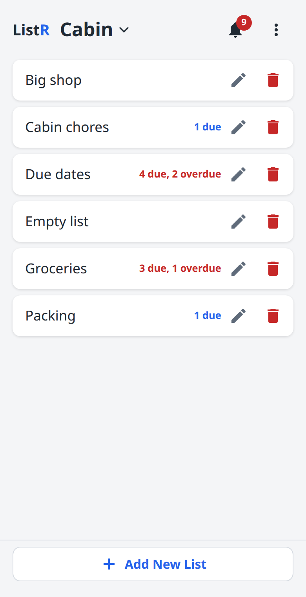
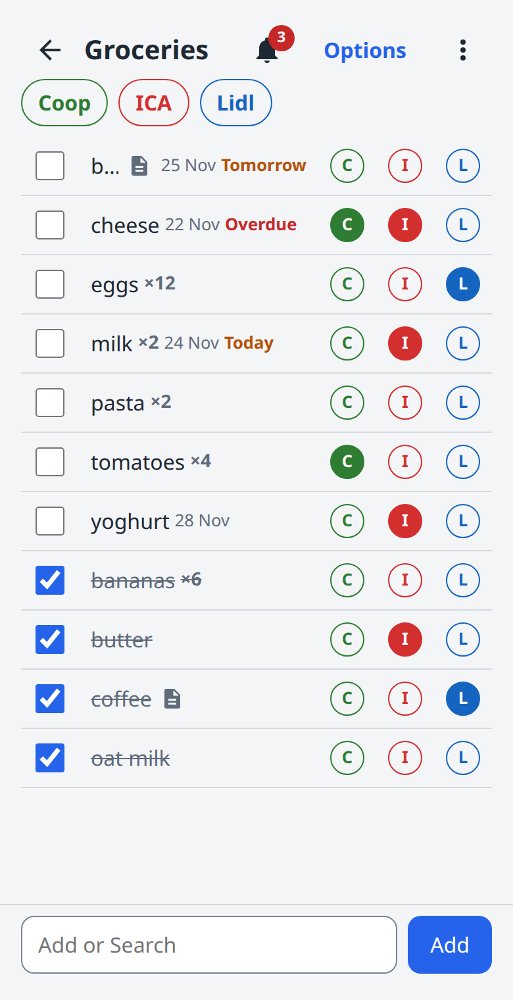
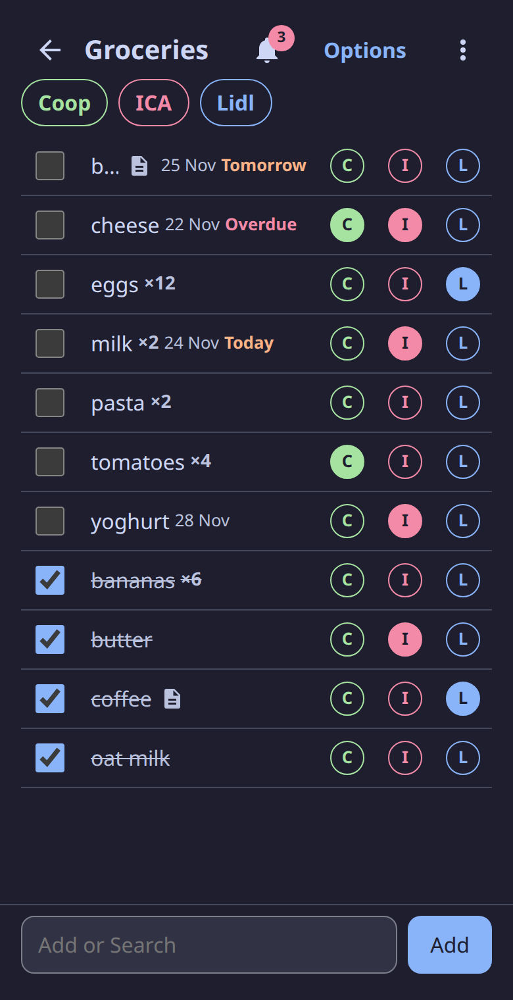
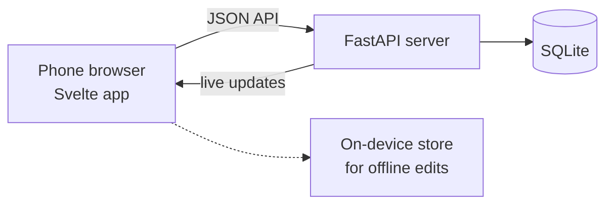

# ListR — shared lists

A mobile-first web app for small groups to share shopping and other lists.

<p>
  
  
  
</p>

## TL;DR

- Share lists in password-protected rooms. Everyone sees changes live.
- Works offline. Edits wait on the phone and sync when the network is back.
- Installs on the home screen like an app.
- Built with Svelte, Python FastAPI and SQLite. Hosted on Railway.
- My first web app, built step by step with AI coding agents.

## Features

- **Rooms and lists:** a room holds a group's lists. A room password protects
  it. Admins send invitation links so people can make their own rooms.
- **Items:** quantities, notes, due dates, tags with colors, and suggestions
  from items you add often.
- **Live updates:** changes reach other open phones at once.
- **Offline use:** view and edit without a network.
- **Public list links:** share one list with someone outside the room.
  Anyone with the link can view and edit that list.
- **Light and dark mode** with six color themes.

## How it works



One Python process serves both the API and the built Svelte app. The
[architecture](ARCHITECTURE.md) explains the decisions.

## Run it yourself

ListR is a hosted app, so there is no one-command install. To run a copy on
your own computer you need:

- Python 3.13 or newer and [uv](https://docs.astral.sh/uv/)
- Node 24 and [Bun](https://bun.sh)
- An `APP_PASSWORD` in `.env` (copy `.env.example`)

```bash
uv sync
cp .env.example .env
(cd frontend && bun install --frozen-lockfile && bun run build)
uv run python src/main.py
```

Before you start the server, edit `.env` and set `APP_PASSWORD` to your own
password. Then open <http://localhost:8080/admin> and sign in with it. The
[development guide](docs/development.md) has the full setup, tests and
frontend development. To host it, see the [deployment guide](docs/deployment.md).

## Quality

- Python tests with pytest, frontend tests with Vitest.
- Real-browser tests in Chromium, Firefox and WebKit, plus an Android emulator
  suite. See the [testing guide](docs/testing.md).
- Ruff for formatting and linting, ty for type checks.

## Repository map

| Path                               | Purpose                                                                    |
| ---------------------------------- | -------------------------------------------------------------------------- |
| `src/`                             | Python server. `main.py` is the entry point.                               |
| `frontend/`                        | Svelte app, built to `frontend/build/`.                                    |
| `tests/`                           | Pytest suite.                                                              |
| `browser_tests/`, `android_tests/` | Real-browser and Android emulator suites.                                  |
| `scripts/`                         | Helpers: deploy with backup, phone serving, test data, icons.              |
| `docs/`                            | Current behavior, contracts and guides. Start at the [hub](docs/index.md). |
| `plans/`                           | The [task entry point](plans/backlog.md) and detail for larger items.      |

[Architecture](ARCHITECTURE.md) · [Development guide](docs/development.md) ·
[All docs](docs/index.md)
